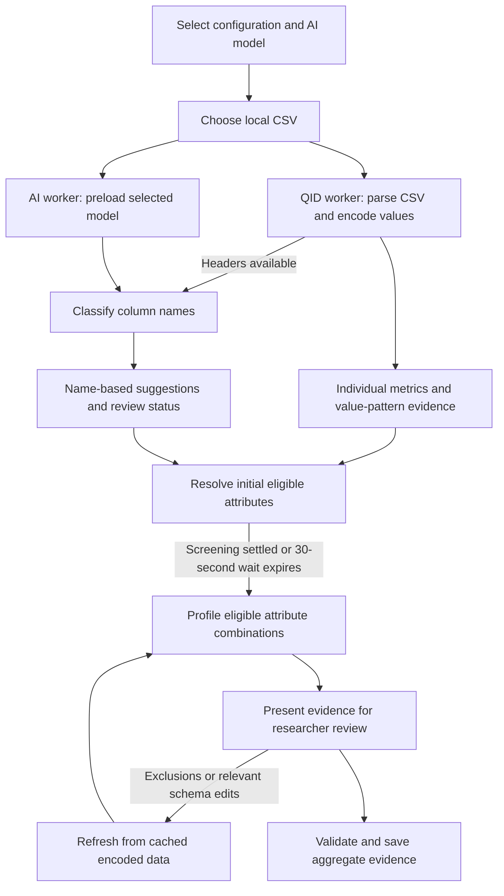

# QID Discovery Assistant

## What this feature does

QID Discovery helps researchers inspect a CSV dataset before performing a data-sharing risk assessment. It combines four distinct forms of evidence:

| Mechanism | Examines | Produces |
| --- | --- | --- |
| **AI classification** | Column names (not patient values) | Semantic suggestions and uncertainty for researcher review |
| **Column-name rules** | Known identifier and quasi-identifier names | Conservative exclusion or review suggestions |
| **Value-pattern detection** | CSV values inside the browser | Evidence for supported identifier-like patterns |
| **Statistical profiling** | Individual columns and eligible combinations | Distinction, Separation, Singleton Fraction and aggregate context evidence |

The researcher reviews potential identifiers and determines which attributes to exclude. The results support REA's later **Replicability, Availability, Distinguishability and Sensitivity (R/A/D/S)** assessment.

**QID Discovery does not** anonymize or rewrite the original CSV, establish a definitive list of quasi-identifiers, estimate a re-identification probability, or automatically assign final R/A/D/S scores.

## How it works

### Nine steps, from CSV to saved dataset

1. **Load settings.** Redux supplies cached QID configurations and model installation status. The form keeps the selected configuration/model IDs locally and locks them when tables are added.
2. **Start two jobs.** Uploading a CSV starts QID preparation and AI model preloading without waiting for one to finish before starting the other.
3. **Screen names early.** The parser reports headers after its first chunk. The AI worker classifies normalized names, using cached inferences where possible; name rules also contribute suggestions.
4. **Prepare values once.** The QID worker parses all rows, encodes equal values with equal integer codes, measures individual columns and detects supported identifier-like value patterns.
5. **Resolve initial exclusions.** Confident eligible decisions are applied in one batch. If name screening remains pending, initial profiling starts after a **30-second wait** with available decisions; late findings remain reviewable.
6. **Profile combinations.** Eligible within-table attribute subsets of sizes 2 through the configured maximum are evaluated, subject to a total-subset safety limit.
7. **Show the evidence.** The interface shows screening status, review controls and available statistical evidence. A classification result is *not* proof that an attribute is safe.
8. **Handle edits.** Relevant schema/exclusion changes trigger another combination profile using the **same browser-local encoded source** and cached subset metrics. Confirmation alone does not trigger recalculation.
9. **Validate and save.** The dataset API receives the schema, final exclusions, selected aggregate statistics, configuration/version identifiers and model provenance when applicable, **not CSV records**.

> [!NOTE]
> The function named `refreshUploadedTableProfile()` runs both the **first** combination profile and subsequent refreshes. It does **not** re-upload or reparse the CSV. CSV preparation and combination profiling are intentionally separate stages.

## Scientific evidence

For `n` analyzed records and equivalence classes of sizes `s_1, ..., s_k`:

| Metric | Definition | Interpretation |
| --- | --- | --- |
| **Distinction** | `k / n` | How many distinct groups exist relative to the number of records |
| **Separation** | `1 - [sum(s_i(s_i - 1)/2)] / [n(n - 1)/2]` | Fraction of record pairs with different values or joint values |
| **Singleton Fraction** | `number of singleton records / n` | Fraction of records belonging to one-record equivalence classes |

Zero-denominator cases are handled by the implementation. Missing values form a shared category rather than being dropped from these calculations.

For a combination of attributes, identical **joint** values form an equivalence class. Each combination contributes evidence to its participating attributes. Means are calculated **separately for each subset size**; contextual display evidence then gives each available subset size equal weight. Do not replace this with a mean weighted by the number of combinations.

These are **descriptive dataset statistics**, not calibrated attack probabilities. They do not establish whether auxiliary data is available to an attacker.

## Identifier decisions and researcher review

- **AI suggestions** arise from column names and model-specific prompts/thresholds. Scores are not probabilities of re-identification.
- **Name rules** can automatically suggest exclusion for strong identifiers, independently of the model, subject to the existing conflict/review policy.
- **Value-pattern evidence** checks email-like, IP-like, formatted-phone and US-SSN-like values. Supported `HIGH` evidence defaults to exclusion and prevents submission if the column remains included.
- **Uncertain findings** may require explicit researcher review; the exact decision depends on the source and screening state.
- **Manual decisions** take precedence over later automatic *name-screening* changes; they do not bypass the separate `HIGH` value-pattern submission rule.

The current model registry does **not** approve any model for **model-only automatic exclusion**. A high model score by itself therefore does not authorize such an exclusion.
